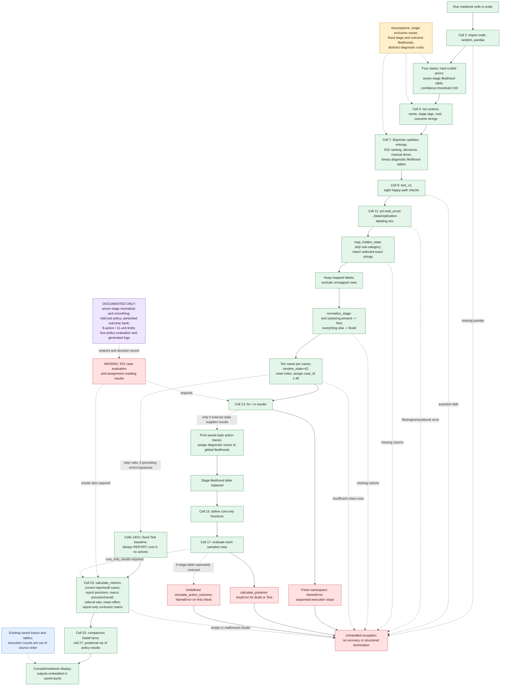
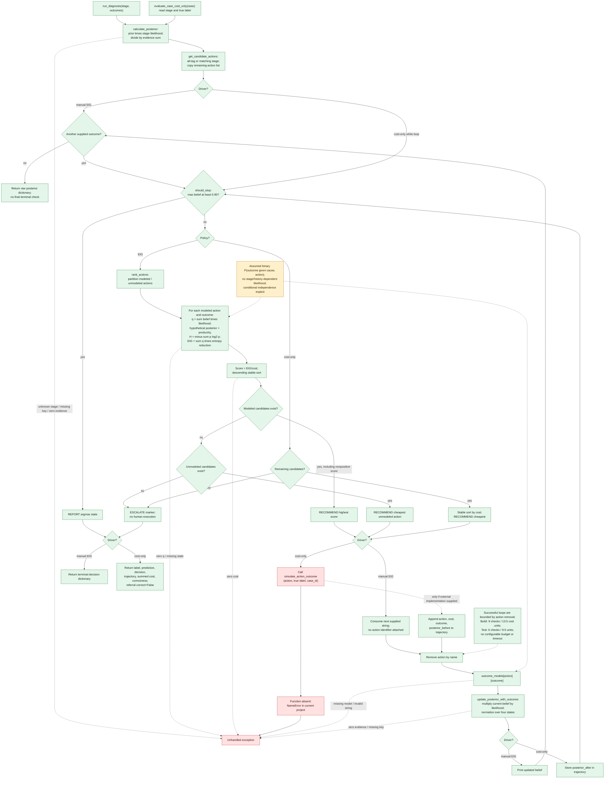
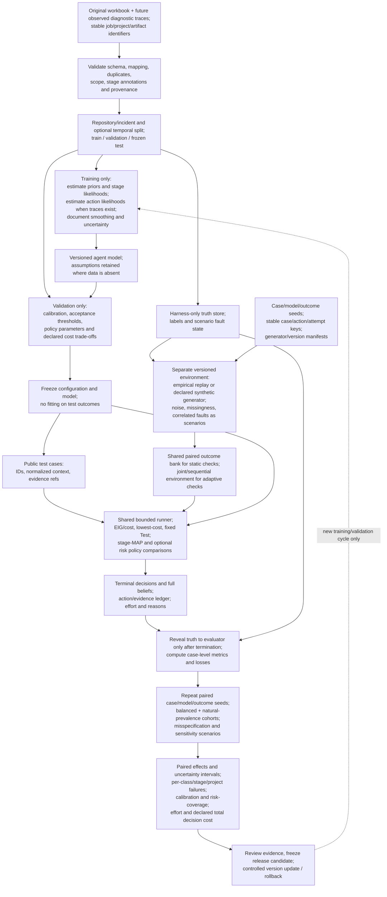

# 1. Detailed Mermaid diagrams of the current implementation

These diagrams describe the source in `experiments/agent_simulation.ipynb`, as inspected on 13 October 2026. Green means implemented code; amber means modeling assumptions; red means missing code or an exception path; purple means described in the newer documents but absent from the executable notebook. Blue identifies saved artifacts. Dashed connections identify conditional execution, dependencies, or documentation rather than a working end-to-end path.



The next diagram expands the actual function calls. The cost-only update path is defined in source, but its simulator dependency is missing. The manual EIG driver consumes caller-supplied outcome strings; it does not generate observations or execute CI checks.



# 2. Explanation of the current workflow and established baseline

## Scope and evidence

The main entry point is [the notebook][notebook], not a script, class, CLI, or live CI integration. There are 27 cells, including 13 code cells. All simulation logic is in notebook globals and functions. No separate simulator implementation, dependency lockfile, executable V2 artifact, or generated case/action log files were found in the project inventory. No applicable `AGENTS.md` was found.

Related material inspected: [README][readme], [research notes][research], [decision record][decision-record], [review record][review-record], [preprint source][preprint], the framework PNG and its identical preprint copy, the two compiled preprints, the literature discussion, and the social discussion records. Research papers provide background; they do not establish notebook capabilities. The hidden `.kilo/worktrees/cumbersome-psychiatrist` copy has exactly the same concatenated executable notebook source; differences in notebook bytes do not supply missing code. Research/review text in that copy is also identical after line-ending normalization.

The initial inspection and probes were read-only. This report is the only added project artifact. No notebook, workbook, model parameter, saved output, or existing project document was changed.

## Execution and information flow

1. **Initialize the model.** Cell 3 defines `Code`, `Test`, `Dependency`, and `CI/Config`, a prior dictionary, seven stage-conditioned likelihood vectors, and `CONFIDENCE_THRESHOLD = 0.90`. These values are hard-coded. The notebook does not estimate them from the workbook.
2. **Register modeled actions.** Cell 5 lists ten inspection/search actions, each with stage tags, declared relative cost, and two human-readable outcome strings. Cell 7 independently defines outcome strings and likelihood vectors for those actions. None calls a live tool.
3. **Prepare cases.** [Cell 11][dataset] reads the workbook using a working-directory-relative path. It strips `sub-category`, maps selected exact strings to one hidden state, and excludes the rest. `normalize_stage` returns `Test` whenever any configured test substring appears and `Build` otherwise. It samples ten rows from each class with `random_state=42` and replaces source row indices with sequential case IDs. Source `job_id`, project and other fields remain in the sampled DataFrame.
4. **Initialize a belief.** [calculate_posterior][posterior] computes `b(s) = prior(s) * P(stage|s) / sum_s prior(s)*P(stage|s)`. Valid current Build input gives approximately `(0.249933, 0.346462, 0.314916, 0.088690)` in state order.
5. **Choose a check.** [decide_next_step][decision] reports the largest belief if it reaches 0.90. Otherwise, eligible modeled checks are ranked by [EIG/cost][eig]. `q(o)=sum_s b(s)P(o|s,a)`, hypothetical posteriors use Bayes' rule, and entropy uses base-2 logarithms. Python's stable sort makes catalogue order the tie-break. Missing-model checks form a separate cost-sorted fallback list. Empty candidates produce `ESCALATE`.
6. **Receive an observation and update.** [run_diagnosis][driver] consumes plain strings supplied by its caller. [evaluate_case_cost_only][cost-evaluator] instead calls an absent simulator with action, true label, and case ID. The Bayesian [update function][update] normalizes the elementwise product. Used actions are removed by name. This prevents repeats of the same registered name but does not identify repeated evidence across different actions.
7. **Stop.** The manual driver checks decisions before each supplied observation, then returns a raw posterior when that iterable ends. The cost-only loop would check again after each successful update, including its last available action, but cannot currently obtain observations. Referral is a return value and print message; no reviewer is contacted or modeled.
8. **Evaluate.** The fixed baseline always reports `Test`. [calculate_metrics][metrics] scores reports, counts referrals, sums declared diagnostic effort, and computes four-class precision/recall. The confusion matrix excludes referral decisions. Its recall denominator still includes every true-class case, so referrals count as missed automatic reports. `total_cost` includes diagnostic costs only. Cell 25 displays a comparison; cell 27 combines results by positional `zip`. There is no durable structured export in source.

## Workbook baseline actually checked

| Quantity | Observed value |
|---|---:|
| Source rows / distinct jobs / distinct projects | 375 / 375 / 260 |
| Mapped rows / excluded rows | 309 / 66 |
| Code / Test / Dependency / CI/Config mapped counts | 54 / 120 / 91 / 44 |
| Distinct projects in mapped pool / sampled panel | 219 / 38 |
| Sampled cases | 40, ten per state |
| Sample Build / Test stages | 26 / 14 |
| Duplicate full source rows | 0 |
| Missing values in original source columns | 0 |

The fixed-seed sample reproduced within the audit environment. This is a check of dataset preparation, not a reproduction of observation generation or complete policy evaluation. Forty cases from 38 projects are not independent validation repositories. The 66 excluded rows include quality, vulnerability, network, version-control, rate-limit, unresolved-action, and performance categories. The current experiment measures the selected mapped population only.

## Executed checks versus historical outputs

Read-only probes used bundled **Python 3.12.14, pandas 3.0.1, openpyxl 3.1.5**. The notebook records Python 3.12.8 but supplies no package versions. The eight original `test_v1` checks passed. Executing code cells in source order then loaded the workbook and failed in cell 13 with `NameError: name 'results' is not defined`. An isolated cost-only case, with an intact stage table, failed with `NameError: name 'simulate_action_outcome' is not defined`.

Notebook SHA-256: `3e8dc01a20397bbd1d7a9f52002bf6eef35c2703bc96e9b7085117303f77c00f`.

Workbook SHA-256: `39647c82583a2039b69fcf57fa30808d46f9bbf3cbcf6caf023921c2588de860`.

The following values were **reconciled from saved outputs**, not generated by a fresh complete simulation:

| Metric | Saved EIG/cost | Saved cost-only | Saved fixed Test |
|---|---:|---:|---:|
| Correct automatic reports / all cases | 22/40 = 55.0% | 21/40 = 52.5% | 10/40 = 25.0% |
| Automatic reports / coverage | 25 / 62.5% | 24 / 60.0% | 40 / 100.0% |
| Wrong automatic reports | 3 | 3 | 30 |
| Selective accuracy, called report precision | 88.0% | 87.5% | 25.0% |
| Referrals | 15 / 37.5% | 16 / 40.0% | 0 |
| Macro precision | 65.625% | 65.625% | 6.25% |
| Macro recall, referrals counted as misses | 55.0% | 52.5% | 25.0% |
| Total actions / average actions | 186 / 4.65 | 214 / 5.35 | 0 |
| Total diagnostic cost / average cost | 262 / 6.55 | 286.5 / 7.1625 | 0 |

Replaying the **stored outcome strings** through the current Bayesian functions reproduced all saved action rankings and terminal gates. The largest difference from four-decimal printed posteriors was `4.9799209463173154e-05`, consistent with display rounding. Cost sums matched, no repeated action names were found, and all **179 shared case/action observations** agreed between the two saved policies. These findings support internal consistency of the stored traces; they do not recover the missing generator, prove its label boundary, or validate its realism.

Both saved diagnostic policies wrongly report `Test` for Code cases 14, 15, and 16. Replaying their outcomes gives final confidence `0.9069955823`. Both have zero correct Code reports in this panel. The final prediction tables differ only at Dependency case 26: EIG reports Dependency, while cost-only refers. No statistically generalizable advantage follows from that one-case difference.

A further exhaustive traversal of the **current EIG policy's reachable binary-outcome tree** found 288 terminal Build paths and 39 terminal Test paths. No Build path reports Test; no Test path reports Code, whose largest reachable probability is `0.8878728526`. Build paths can report Code, so the saved zero Code recall is not a universal impossibility. These are attainability checks under the fixed policy/model, not performance estimates: paths have unequal probabilities, and the two slightly non-normalized models still require correction.

# 3. Confirmed bugs and design limitations, with code references

Locations below use **one-based notebook cell numbers and source lines within that cell**. Clickable references point to verified raw `.ipynb` JSON lines. Severity reflects reproducibility and unsupported diagnostic conclusions in this simulation, not an invented production incident. No Critical defect was established.

## Confirmed defects, including reproducible latent input failures

| ID / severity | Exact location | Current behavior | Why it is a problem | Reproduction or concrete example | Recommended correction | Correction test |
|---|---|---|---|---|---|---|
| B01 **High** | [Cell 13, line 1][missing-results]; [cell 15, lines 86-90][missing-simulator]; cell 23, line 104 | EIG evaluation consumes an undefined global `results`; cost-only calls undefined `simulate_action_outcome`. | Complete evaluation cannot execute from clean source; saved output is not reproducible methodology. | Source-order execution stops at `results`; isolated first cost-only case reaches the missing simulator. The `results` local in `evaluate_baseline` does not create the required global. | Recover and version the actual missing evaluator/simulator if available. Otherwise specify a new simulator as a new experimental baseline, with explicit truth isolation and common outcomes. Do not pretend it reproduces the historical generator. | Fresh process/kernel executes every cell; 40 validated terminal records per existing policy; missing generator produces a clear configuration error. Separate historical output reconciliation from newly generated runs. |
| B02 **High** | [Cell 13, lines 18-22][shadowing]; [cell 3, line 61][posterior] | Trace printing assigns an outcome vector to global `likelihoods`, replacing the stage table used by inference. | Display code changes subsequent diagnoses and makes execution order affect correctness. | Supply a one-action trace fixture to cell 13, then `calculate_posterior('Build')`: `KeyError: 'Build'`. Saved cell 13 has execution count 42, after later cells, which explains why stored results do not reveal this source-order failure. | Use a local display variable and separate immutable model configuration from trace rendering. | Beliefs and model checksum remain identical before/after trace rendering; repeat cells in a fresh run without global corruption. |
| B03 **High** | [Cell 5 action catalogue][actions]; [cell 7, lines 214-255][outcomes]; cell 7, lines 198-200 | Nine of ten action outcome sets differ from their model keys. | A caller following the catalogue can provide a declared valid outcome that inference rejects. | First Build recommendation is recent code/test changes. Catalogue string `Relevant code/test change found` causes `KeyError`; model expects `Relevant change found`. Runbook search is the only fully matching pair. | Define canonical action/outcome IDs once; keep display labels separate; validate registry/model key agreement. | Every advertised outcome can be consumed for its action; misspelled IDs receive an explicit invalid-observation result rather than a crash. |
| B04 **High** | [Cell 7, run_diagnosis, lines 170-211][driver] | Decision check precedes observations; iterable exhaustion returns raw belief, without final reporting/referral check. Return type varies by path. | Last evidence can justify a report that never occurs; an empty input returns no explicit investigation status. | `run_diagnosis('Build', ['No relevant change found', 'Dependency-related change found'])` returns a belief with Dependency `0.9917319545`, although `should_stop` returns true. `outcomes=[]` returns the initial belief. | Shared runner checks terminal conditions after each update and on input exhaustion. Return one typed result containing decision, reason and final belief; allow an explicit incomplete status only if the caller contract supports resumption. | Report on the final permitted observation; test empty/incomplete input, exact threshold, action exhaustion and resumable contract separately. |
| B05 **Medium** | [Cell 7, lines 220-221 and 240-241][binary-sums]; [cell 3 parameter tables][parameters] | Two Test binary likelihood pairs sum to 1.001; prior sums to 0.9999; Test/Dependency stage columns sum to 0.999/1.001. | EIG treats a non-unit predictive branch mass as a probability distribution. Rounded parameter tables are not validated. | Stage clue and runbooks use `0.938 + 0.063`. For belief `b`, either affected action has total predictive branch mass `1 + 0.001*b(Test)`. | Resolve intended complements or explicitly normalize and version the correction. Validate distributions along the correct axis. The common prior scale cancels in a posterior; the binary branch inconsistency does not. | Check prior sum, sum over stages for each cause, and sum over outcomes for each action/cause. EIG agrees with a normalized reference and lies between zero and current entropy within numerical tolerance. |
| B06 **Medium** | [Cell 7, calculate_eig, lines 17-33][eig]; [update, lines 142-156][update]; cell 3, lines 70-76 | Divide by zero for an impossible hypothetical outcome or actually observed zero-evidence outcome. | A mathematically valid model may contain an impossible branch; observed contradictions require explicit model-mismatch handling. | EIG on one all-zero branch plus one all-one branch raises `ZeroDivisionError`; update with all-zero likelihoods does likewise. These cases are not reached by the current positive diagnostic table. | Skip hypothetical branches with `q=0`. Reject/referral on an actually observed `q=0`, preserve previous belief and ledger, and identify inconsistency. Validate stage evidence similarly. | Deterministic/no-information models produce valid EIG; zero-evidence observations never fabricate a posterior or crash the episode. |
| B07 **High** | [Cell 3, should_stop][stop]; [cell 7, entropy/update][update] | No shape, finiteness, sign, range or normalization checks. Negative likelihoods produce negative beliefs; NaNs propagate; invalid belief totals can pass reporting. | Invalid numerical state can lead to an unsupported terminal claim, beyond merely failing a calculation. | An update with Code likelihood -1 and others 1 returns Code about -0.4997. Four beliefs all equal 0.95 trigger `(True, 'Code')`. All-NaN likelihoods return NaN beliefs. | Validate all public inputs and outputs; distinguish malformed input from tiny rounding deviations; reject negatives/NaN/infinity and mismatched keys before any policy decision. | Parameterize malformed values, missing/extra states, empty belief, wrong totals and non-finite costs; every invalid case terminates or returns an explicit validation error without reporting. |
| B08 **Medium, latent** | [Cell 7, rank_actions/decide_next_step][decision]; cell 7, lines 198-200 | Unmodeled checks are explicitly recommended, but the driver then unconditionally indexes their absent model. | The fallback cannot execute safely when a model is unavailable. All ten current checks have models, so this is dormant in the existing panel. | An unmodeled one-unit candidate is recommended with `eig=None`; the driver attempts the missing model key. | Reject incomplete action registrations; mark unavailable models/tools ineligible; retain a fallback only if it has an executable, defined observation contract. | Remove one/all action models; remaining supported actions continue, otherwise referral includes the unavailable reason. |
| B09 **Medium, latent** | [Cell 7, rank_actions, lines 53-62][ranking] | Zero cost divides by zero; negative cost is accepted into ranking. | Configurable or measured costs could invalidate selection and later budget accounting. Current declared costs are all positive. | Rank pipeline logs with `cost=0`: `ZeroDivisionError`. | Require finite strictly positive declared selection costs and nonnegative measured incurred effort; use an explicit policy if genuinely free checks are ever supported. | Zero, negative, NaN and infinite costs are rejected before ranking; positive-cost ties remain deterministic. |
| B10 **Medium** | [Cell 23, calculate_metrics, lines 19-33 and 80-81][metrics] | Empty results divide by zero; no reports are presented as report precision 0; empty class lists also break aggregation. | Undefined metrics are confused with observed poor performance, and failed cohorts have no valid summary. | `calculate_metrics([], states)` raises `ZeroDivisionError`. With only referrals, selective accuracy is undefined, not zero. | Validate result/class schema; emit metric value plus denominator/status; use null/not-applicable for unsupported estimates. | Empty cohort, all referrals, missing classes and invalid result labels return explicit statuses; reported metrics match hand-counted examples. |
| B11 **Low, latent** | [Cell 27, lines 5-15][zip] | Policy outputs are paired by position; `zip` silently truncates the shortest list. | Reordering or a dropped case can create false comparisons or hide missing evaluations. Saved lists currently align. | Reverse a cost-result list or remove its last item: comparison still prints without checking matching IDs. | Join on stable case ID, require unique IDs and identical case sets, assert true-label agreement. | Reordered lists yield identical comparison; missing, duplicate or inconsistent IDs produce a clear validation failure. |

## Design, model, evaluation and reliability limitations

These are not automatically software bugs. The examples expose the current scope or assumptions and define how a justified improvement would be evaluated.

| ID / severity | Exact location | Current behavior | Why it matters | Concrete evidence or scenario | Recommended correction | Validation method |
|---|---|---|---|---|---|---|
| L01 **High** | [Cell 11, normalize_stage, lines 38-47][normalizer]; cell 3 stage table | Coerces every missing/unmatched/setup/deploy/analysis description to Build; substring matches include `skipTests` and `contest`. Only two of seven stage labels enter evaluation. | Missing context becomes affirmative Build evidence and controls action eligibility. Stage grammar and likelihood vocabulary are inconsistent. | `None`, NaN, empty string, `deploy to production`, `install dependencies`, and `lint` all map to Build; `contest build` maps to Test. Saved Code cases 14/15 have `Build with Maven skipTests` but are marked Test. Hosting inspection is never evaluated. | Prefer structured CI stage metadata; otherwise use a tested seven-stage parser with Unknown/Ambiguous, token boundaries and skip/negation handling. Define its precedence and refit stage likelihoods for that vocabulary. | Fixtures for missing, multi-stage, skipped tests, setup/build/deploy/quality and ambiguous inputs; confusion matrix against independently labeled stages; confirm correct eligible-action sets. |
| L02 **High** | [Cell 3 threshold and should_stop][stop]; [cell 7 decide_next_step][decision] | A fixed 0.90 model posterior alone permits a report; no validated calibration, unequal error loss or review alternative informs that threshold. | Model confidence is conditional on assumed likelihoods; it does not certify 90% empirical correctness. | Saved wrong Code-to-Test reports reach about 90.70%; selective accuracy is 88% in 25 EIG reports. This small panel is not a statistical calibration test. | Tune acceptance against declared error tolerance/cost on separate validation repositories; freeze before test. Retain posterior and calibration uncertainty; referral must remain available for mismatch or unsupported scope. | Reliability/risk-coverage curves, per-class coverage, high-confidence errors, calibration uncertainty and held-out selective risk. Check shifted/noisy scenarios separately. |
| L03 **High** | [Cell 3 hard-coded model][parameters]; [cell 5 costs][actions]; [cell 7 outcomes][outcomes] | Priors, stage/action likelihoods and costs are constants, without executable estimation, provenance or uncertainty. Workbook supplies labels/context, not diagnostic-action observations or measured effort. | The likelihood/action/cost assumptions dominate policy behavior and are not established by source data. Balancing the test panel does not make source priors match that panel's prevalence. | Many positive probabilities are 0.978/0.991/0.988/0.972; no associated trace sample sizes exist in code. The workbook cannot supply those action measurements. | Version assumptions explicitly now. Estimate priors/stage likelihoods on training data using a consistent normalizer; later collect diagnostic traces and measured time/API/engineer costs. Retain a declared synthetic model until then. | Estimator hand-count checks; training-only provenance; uncertainty intervals; prior/prevalence, likelihood and cost sensitivity; observed-trace validation before operational claims. |
| L04 **High** | [Cell 7 fixed update likelihoods][update]; [action registry][actions] | Successive signals are treated as conditionally independent given one cause; outcomes ignore stage, history, tool reliability and evidence provenance. | Two checks may reuse the same log clue. Action-name removal does not prevent evidence duplication or overconfidence. | Pipeline logs, failed-stage inspection and runbooks can describe the same failure signal. Current binary models cannot distinguish failed retrieval from a valid absence of signal. | Track artifact/event provenance; distinguish negative signal, inconclusive, unavailable and tool error. Avoid exact evidence reuse; assess dependence and model it only where data supports it. | Duplicate-artifact tests leave beliefs unchanged; correlated-outcome simulations and real trace residual checks expose overconfidence; failed measurements do not act as negative evidence. |
| L05 **Medium** | [Cell 3 stage zeros][parameters]; [cell 7 update][update] | Some stages assign exact zero to modeled causes; multiplication preserves zero forever. | If zero means sparse historical data rather than impossibility, later contrary evidence cannot recover the cause. The binary evaluation does not exercise these stages. | Deploy/Publish starts Code and Test at zero; even a Code-favoring `.999` versus `.001` likelihood leaves Code at zero. Setup/Dependency excludes Test. | Smooth sample-derived zeros with documented strength; retain structural zeros only when justified. Do not add arbitrary epsilon merely to force desired predictions. | Plausible contrary evidence can recover supported sparse causes; truly impossible combinations remain zero; smoothing strength is evaluated out of sample. |
| L06 **High** | [Cell 3 state list][parameters]; [cell 11 mapping/filter][dataset] | Exactly one exclusive category is represented; 66/375 rows are removed. `Test` labels describe failing tests, not necessarily defective test code. CI/Config combines several mechanisms. | Outside-scope, multi-fault and symptom/cause cases cannot be truthfully represented by one of these four probabilities. A normal operational input lacks the true label needed for current filtering. | Network/rate-limit failures are excluded; simultaneous dependency and configuration faults have no state. A test can expose a source-code defect. | State the task as classification of mapped failure labels. Add detectable outside-scope handling/referral; clarify annotation rules. Extend to unknown/multiple causes only after evidence and labels support the new representation. | Annotator agreement and adjudication; excluded-category challenge set; mixed-fault stress cases must not yield unsupported single-cause certainty. Validate a multi-label model separately if introduced. |
| L07 **High** | [Cell 7 policy and stage filtering][decision]; saved cells 13/27 | One-step EIG/cost optimizes modeled uncertainty, not complete diagnostic utility. Stage eligibility and similar Code/Test likelihoods constrain discriminability. Zero-EIG actions are still selected. | Low-effort information can be irrelevant to a safe report; some class/stage combinations cannot reach the reporting gate under the fixed policy. | A valid all-state `.5/.5` action has EIG 0 but is recommended. Exhaustive current-policy paths give no Test report for Build and no Code report for Test. Saved Code recall is zero, but Build Code-report branches exist. | Keep EIG/cost as a corrected baseline. Review stage eligibility and actual discriminating evidence; add a specified no-information rule. Later compare risk-aware selection and limited lookahead without tuning likelihoods to the test panel. | Reachability tests with controlled models, per-stage/class error analysis, zero-information candidates, and paired policy comparisons under fixed cases/outcomes. Multi-step utility counterexample in section 6. |
| L08 **High** | [Cell 7 run_diagnosis][driver]; [cell 15 evaluator][cost-evaluator] | No configurable step/cost limit, wall-clock deadline, availability/precondition check or explicit failure recovery. Successful action removal nevertheless bounds the present finite catalogue. | Investigations can exceed documented resource limits and cannot safely absorb unavailable future tools. This is not a confirmed infinite-loop bug. | Saved episodes use 9 actions and cost 13.5, exceeding the newer documents' 8/11 configuration. Current Build catalogue bound is 9/13.5; Test is 6/9.5. | Shared runner enforces configured resources before actions, charges incurred effort, validates results, limits retries and rechecks terminal gates after the last affordable action. Add timeouts when real adapters exist. | Boundary budgets, unaffordable candidates, exhausted steps, deadlines and all-tools-unavailable return reasoned referral; retries/errors cannot bypass accounting. Preserve finite action removal. |
| L09 **High** | [Cell 11 sample][sampling]; [absent EIG/simulator paths][missing-results]; [preprint test method][test-method] | One balanced 40-case sample; sampling seed only; no repository-disjoint validation/test split or uncertainty intervals. Original parameter origin and generator are unavailable. Newer preprint explicitly estimates and samples from the same mapped pool. | A one-case difference cannot establish policy superiority or generalization. Case balancing changes the evaluation population. Common stored observations are reassuring but do not regenerate a paired experiment. | Sample has 38 projects; saved policies differ on only case 26. Preprint describes in-sample initialization and one perturbed outcome bank. | Split by repository/incident, and time where possible, before estimation; tune on validation only; repeat case/model/outcome seeds; preserve stable source IDs and paired bank hashes; report balanced and natural-prevalence cohorts. | Disjoint-set assertions, repeated paired differences, clustered uncertainty intervals, leave-one-case/project-out influence checks, and external trace evaluation. Do not claim direct label leakage from code that is absent. |
| L10 **Medium** | [Cell 15 trajectory/result fields][cost-evaluator]; [cell 23 metrics][metrics] | Console/notebook traces lack model version, evidence provenance, reason codes, final belief in terminal result schema and reliable structured export. Metrics omit probability scoring, calibration, coverage as a named metric, distribution of effort and total decision loss. | Confidence/error analysis and reconstruction require parsing text. Referrals and difficult classes can be hidden by aggregates. | `total_cost` is diagnostic effort only; no-report precision is set to zero; a zero-action result has no stored final posterior. Human-review correctness and cost are unobserved. | Store typed case/action records including final beliefs for reports and referrals; name denominators; add probability, selective, class/stage, effort and declared terminal-loss metrics. Preserve source IDs and manifest hashes. | Round-trip/replay ledger; hand-counted confusion including referral column; Brier/log-loss references; consistency among coverage, referral, correct reports and selective accuracy; cost reconciliation. |
| L11 **Medium** | [Cell 9 test_v1][unit-tests]; project dependency inventory | Eight narrow checks cover valid examples; ranking tests do not establish order and EIG test only asserts nonnegativity. No complete-run regression or pinned dependency manifest exists. | Happy-path success does not protect evaluation, terminal decisions or edge probabilities. | All eight checks pass while B01-B04 remain. Notebook metadata records interpreter only. | Add meaningful mathematical, state-transition and integration checks; record supported runtime/dependencies and a clean execution command. Keep notebook presentation separate from reusable functions when practical. | Independent hand calculations, controlled adversarial fixtures and fresh-process execution; stable input/result manifests across identical runs. |
| L12 **High** | [Decision record, policy/reproduction][decision-record]; [preprint normalization and test claims][preprint]; [README status][readme-status] | New documents describe smoothed initialization, seven-stage normalization, risk/cost, resource limits, four policies, and 160 terminal/564 action records. Notebook contains the earlier incomplete three-policy experiment. | Readers cannot reproduce the claimed V2 method from this checkout. Claimed results cannot be treated as verified current functionality. | Decision record's reproduction section lists no actual log filenames; no risk policy or generated log files exist. README correctly acknowledges the older incomplete notebook. | Recover exact version/artifacts underlying V2; align code, model/version manifest, logs and documents. If unavailable, mark V2 claims as externally unverified and keep a newly specified experiment distinct. | Every paper table and decision trace is regenerated from a named executable version and machine-readable logs; source/version/checksum links agree. |

The action catalogue currently contains only modeled inspect/compare/search operations. No source, infrastructure, deployment or runtime mutation is executed. It would be incorrect to label the present simulation as an implemented production-remediation hazard. Permissions, least privilege, dry runs and approval become integration requirements if state-changing adapters are later introduced; they are not grounds to block this read-only audit.

# 4. Detailed Mermaid diagrams of the proposed robust architecture

Everything in this section is **proposed**. It preserves the current four-state Bayesian core, declarative actions, stage eligibility, action removal, EIG/cost baseline, cost-only baseline and transparent trace intent. A small shared runner, validated configuration, observation interface and ledger are sufficient; a distributed service or unrestricted autonomous agent is unnecessary.

```mermaid
flowchart TD
    CONFIG["Versioned configuration:<br/>states, stage vocabulary, priors,<br/>likelihoods, costs, policy, limits,<br/>acceptance rule and assumption provenance"] --> VALIDATE{"Schema and model valid?<br/>Exact IDs; finite nonnegative probabilities;<br/>conditional sums; positive declared costs"}
    VALIDATE -->|"no"| CONFIGFAIL["Reject experiment configuration;<br/>record validation failures;<br/>do not issue diagnoses"]
    VALIDATE -->|"yes"| INTAKE["Validated public case intake:<br/>stable source ID, stage/context/artifact refs;<br/>truth and label-bearing fields excluded"]
    INTAKE --> SCHEMA{"Required evidence valid?"}
    SCHEMA -->|"no usable intake"| REFER["Terminal referral with reason,<br/>final valid belief or unavailable belief,<br/>evidence and resource ledger"]
    SCHEMA -->|"yes / explicit partial evidence"| NORMALIZE["Consistent stage normalization:<br/>structured metadata preferred;<br/>Unknown / Ambiguous / missing explicit"]
    NORMALIZE --> INITIAL["Initialize supported belief;<br/>apply verified stage evidence once;<br/>missing evidence uses declared neutral model"]
    INITIAL --> CHECK["Check numerical integrity,<br/>model support and observation consistency"]
    CHECK -->|"invalid / unsupported / mismatch"| REFER
    CHECK -->|"valid"| GATE{"Acceptance criteria met?<br/>held-out calibration + configured risk tolerance;<br/>supported class and valid evidence"}
    GATE -->|"yes"| REPORT["Terminal report:<br/>label, posterior, calibrated confidence if available,<br/>assumptions, supporting evidence and caveats"]
    GATE -->|"no"| ELIGIBLE["Action registry filters:<br/>stage/context, unused action/evidence,<br/>model + adapter available, permission,<br/>preconditions, remaining budget/steps/time"]
    ELIGIBLE --> FEASIBLE{"Any feasible check?"}
    FEASIBLE -->|"no"| REFER
    FEASIBLE -->|"yes"| SELECT["Policy interface:<br/>corrected EIG/cost retained;<br/>cost-only baseline;<br/>optional validated risk policy / lookahead"]
    SELECT --> USEFUL{"Continuation justified by<br/>the selected policy and resource rule?"}
    USEFUL -->|"no"| REFER
    USEFUL -->|"yes"| RESERVE["Reserve bounded effort;<br/>assign action/attempt/event IDs"]
    RESERVE --> EXECUTE["Observation provider:<br/>hidden simulator or replay adapter;<br/>future read-only CI adapter"]
    EXECUTE --> EVENT{"Typed observation event"}
    EVENT -->|"valid positive / negative signal"| PROVENANCE["Validate action/outcome pairing;<br/>check artifact identity and dependence"]
    PROVENANCE --> DUP{"Already consumed evidence?"}
    DUP -->|"yes"| ACCOUNT["Record event and incurred effort;<br/>belief unchanged;<br/>mark attempt/action state"]
    DUP -->|"no"| PREDICT["Compute predictive q from model"]
    PREDICT --> Q{"Observed q positive?"}
    Q -->|"no"| MISMATCH["Record model inconsistency;<br/>preserve previous belief"] --> REFER
    Q -->|"yes"| UPDATE["Stable Bayesian update:<br/>log weights + logsumexp when needed;<br/>validate normalized finite posterior"]
    UPDATE --> ACCOUNT
    EVENT -->|"missing / inconclusive / tool error / timeout"| FAILURE["Do not treat as negative signal;<br/>use missingness model only if validated;<br/>record reason and incurred effort"]
    FAILURE --> RETRY{"Eligible bounded retry/recovery?<br/>deadline and budget still permit it"}
    RETRY -->|"yes"| RESERVE
    RETRY -->|"no"| ACCOUNT
    ACCOUNT --> CHECK
    REPORT --> LEDGER["Structured terminal/action ledger:<br/>model and input hashes; policy scores;<br/>event provenance; before/after beliefs;<br/>effort, limits and stop reasons"]
    REFER --> LEDGER
    SELECT -. "candidate scores and rejection reasons" .-> LEDGER
    UPDATE -. "accepted evidence and belief transition" .-> LEDGER
    FAILURE -. "failure/retry trace" .-> LEDGER
    LEDGER --> OUTPUT["Explainable case report;<br/>replayable experiment artifacts;<br/>metrics with denominators and undefined status"]
```



A retry must charge previous incurred effort before another reservation. `ACCOUNT` is idempotent for an event ID, and retries count against configured attempt/time/effort limits. Every route back into decision-making checks acceptance before considering another action, including after the final permitted update. A final result always has a defined terminal reason; a configuration failure is distinct from a diagnostic referral.

For hypothetical EIG branches, `q=0` contributes zero and is skipped before division. For an actual `q=0` observation, normalization is undefined: preserve the trace and refer for model mismatch. With the present small catalogue, ordinary multiplication is adequate once validated; log-space arithmetic protects future small likelihoods/long traces without pretending current underflow has been observed. Exact zero support remains explicit.

Missing and inconclusive observations do not automatically mean that a diagnostic signal was absent. Model an informative missingness process only if data supports it. Soft conflicting evidence can legitimately shift a Bayesian posterior; low predictive probability, provenance conflict and persistent model mismatch need explicit checks rather than an arbitrary rule that every disagreement is invalid.



The shared outcome bank is an experimental control, not independent test data or proof of empirical realism. Stable seed/key construction must not use process-dependent Python `hash()`. Repeated checks on the same artifact need declared correlation semantics; a new retry is not automatically an independent new diagnostic signal. Future actions that alter the environment need a sequential simulator and a separately authorized operational design.

# 5. Prioritized changes and implementation plan

**Implement Phase 1 first.** Until clean execution, canonical observation keys and terminal decisions are correct, changing the policy cannot produce an interpretable comparison. Phase 2 makes failures and limits explicit. Phase 3 supplies the data needed for credible probabilities and costs. Phase 4 evaluates additional decision rules after the baseline is trustworthy.

No implementation has begun. Proposed paths and interfaces below are design choices, not existing files or capabilities. A small `model / policy / runner / simulator / evaluator` separation can live in ordinary Python modules with a notebook importing them; preserve the notebook as the existing exploration interface. Recover the author's exact V2 artifact before replacing or claiming to reproduce it.

## Phase 1: confirmed bugs and correctness fixes

| Priority | Current issue | Required change | Expected benefit | Complexity | Validation method |
|---|---|---|---|---|---|
| P0 essential | B01 missing evaluator/generator; L12 source/document mismatch | Recover exact artifacts or explicitly define a new baseline; one clean-run command; identify historical versus regenerated output. | Executable and auditable methods. | Medium; historical recovery may require unavailable artifacts | Fresh-process full evaluation; version/hash provenance; all tables derived from records. |
| P0 essential | B02 display corrupts model | Local trace variables; explicit model ownership; printing cannot mutate configuration. | Order-independent inference. | Low | Model/belief equality before and after printing. |
| P0 essential | B03 incompatible outcome names | Canonical IDs and registry/model validation. | Advertised observations are consumable. | Low | Every catalogue outcome accepted for its action; unknown IDs rejected. |
| P0 essential | B04 incomplete terminal decisions | Shared runner; post-update/final-action stop check; consistent result schema. | Every complete episode ends with a reasoned report/referral. | Medium | Last-observation report, empty input, exact threshold, exhaustion. |
| P1 essential | B05/B06 probability errors | Version normalized tables; skip impossible hypothetical branches; actual zero evidence is a model mismatch. | Correct EIG expectations and safe Bayesian behavior. | Low-Medium | Independent arithmetic, conditional sums, deterministic branches and contradictory observation tests. |
| P1 essential | B07-B11 malformed inputs and summaries | Validate belief, registry, cost and results; case-ID joins; undefined metric statuses. | Prevent unsupported reports and misleading comparisons. | Medium | Negative/NaN/zero-cost/unmodeled/empty/reordered-case fixtures. |

## Phase 2: robustness, uncertainty handling and safety

| Priority | Current issue | Required change | Expected benefit | Complexity | Validation method |
|---|---|---|---|---|---|
| P1 essential | L01 stage/context coercion | Explicit Unknown/Ambiguous; tested normalization grammar; consistent stage vocabulary and evidence contract. | Avoid false Build/Test evidence and eligibility errors. | Medium | Labeled stage fixtures, skipTests/missing/ambiguous cases, parser evaluation. |
| P1 essential | L08 no explicit limits/recovery | Configuration limits for actions, effort, attempts and elapsed time; adapter availability; bounded failures and referral reasons. | Predictable investigation effort and safe termination. | Medium | Boundary accounting and unavailable/error/timeout scenarios. |
| P1 essential | L04/L10 missing evidence semantics and ledger | Typed events; canonical action pairing; provenance/deduplication; persistent before/after/final beliefs and manifest. | Explainable replay; distinguish failed checks from negative evidence. | Medium | Event replay, duplicate-artifact identity, failed-tool belief invariance and cost reconciliation. |
| P1 essential before operational reporting | L02 unsupported confidence interpretation; L06 scope | Validate acceptance on held-out repositories; expose uncertainty and outside-scope referral; advisory output until that evidence exists. | Evidence-based reporting/referral decisions. | Medium-High; requires suitable data | Frozen risk-coverage evaluation, high-confidence error audits, excluded-scope challenge set. |
| P2 essential specification | L07 zero-score continuation | Define no-information stopping and continuation semantics. Keep corrected EIG/cost default; do not import an unjustified risk gate. | Avoid knowingly useless checks. | Low-Medium | All-zero EIG set, ties, tiny-score tolerance and useful multi-step sequence checks. |

## Phase 3: simulation realism and empirical parameter estimation

| Priority | Current issue | Required change | Expected benefit | Complexity | Validation method |
|---|---|---|---|---|---|
| P1 essential for generalization claims | L03/L09 unverified parameters and in-sample panel | Repository/incident splits before fitting; training-only prior/stage estimation; repeated paired experiments; natural-prevalence evaluation. | Defensible generalization and uncertainty estimates. | Medium | Split leakage assertions, estimator checks, repeated clustered paired intervals. |
| P1 essential for operational claims | L03/L04 assumed observations/costs | Collect real read-only diagnostic traces, outcome definitions, reliability and incurred effort; version generator separately from agent likelihoods. | More realistic probability/cost models. | High; external evidence required | Held-out trace likelihood/calibration checks and measured effort; broad misspecification stress tests. |
| P2 essential model review | L05/L06 structural zeros and category ambiguity | Document zero support; estimate smoothing; adjudicate taxonomy and excluded classes. | Recovery from sparse data and honest label scope. | Medium-High | Annotation agreement, smoothing sensitivity, sparse/unknown/mixed-fault challenge sets. |
| P2 optional extension | L06 simultaneous faults | Add unknown/multi-fault representation only with matching labels and observations. | Wider incident coverage. | High | Multi-label ground truth and dedicated metrics; retain categorical baseline. |

## Phase 4: advanced decision-making and performance improvements

| Priority | Current issue | Required change | Expected benefit | Complexity | Validation method |
|---|---|---|---|---|---|
| P2 optional | L07 entropy may not align with decision loss | Compare expected reporting-risk reduction/cost, with a practitioner-supported loss/review model and common cost units. | Potentially better cost/error/referral trade-offs. | Medium | Same cases/outcomes/limits; frozen costs; total-decision-cost sensitivity and paired intervals. |
| P3 optional | One-step planning and overlapping signals | Bounded lookahead or explicit exploration fallback; dependence-aware models only when justified. | Potentially value useful action sequences and reduce double-counting. | High | Two-check counterexample, correlated evidence, computational effort and held-out utility. |
| P3 optional | Repeated probability calculations | Cache validated action models or vectorize stable arithmetic after profiling. | Lower evaluation compute cost. | Low-Medium | Identical decisions/beliefs within declared tolerance; measured runtime/memory comparison. |

The preprint's configured risk cap is redundant with its 90% gate and stated loss matrix: worst wrong-label loss is 65, so confidence 0.90 implies report risk at most 6.5, already below cap 8. MAP/minimum-risk agreement also follows for that particular matrix at the gate. This is a documented design property, not an extra implemented safety check. Retaining the fields may help future configurations, but testing must show when each gate actually constrains decisions.

Likewise, positive `expected risk reduction / cost` does not establish that the risk reduction exceeds the cost of the check. An operational value calculation needs commensurate diagnostic/report/review costs and feasible terminal choices. A greedy positive-score guard can also reject a useful sequence when no individual action immediately changes the report decision. Do not claim risk/cost or lookahead improves performance until that policy is implemented and tested under declared conditions.

# 6. Testing and validation strategy

## Meaningful mathematical and runner tests

Use independently specified expected answers rather than asserting that two calls to the same implementation agree. Keep actual historical observation generation separate from replay tests and from a newly defined simulator.

| Test area | Cases and expected behavior |
|---|---|
| Bayesian arithmetic | With prior `(0.5,0.5,0,0)` and likelihood `(0.8,0.2,0.5,0.5)`, posterior is `(0.8,0.2,0,0)` and evidence probability is 0.5. Positive scaling of a valid likelihood vector leaves posterior unchanged. Result is finite, nonnegative and sums to one. |
| EIG correctness | Under the same two-state prior and symmetric `.8/.2` binary observation model, EIG is `1-H(0.8,0.2)`, approximately `0.2780719051` bits. Identical per-state `.5/.5` models have zero EIG; a perfect distinguishing action has one bit. Compare the full ranking to independent expectations. |
| Normalization axes | Priors sum across states; stage probabilities sum across stages for each state; action probabilities sum across outcomes for each action/state. A vector `P(outcome|state)` does **not** have to sum across states. Correct both 1.001 binary pairs before new evaluation. |
| Invalid input | Missing/extra state/action/outcome IDs, nonnumeric input, negatives, values above one where disallowed, NaN/infinity, wrong belief totals, empty belief and nonpositive declared costs: explicit validation failure, no report. Small roundoff corrections have a documented tolerance and trace. |
| Missing and inconclusive evidence | Missing stage maps to Unknown, not Build. Inconclusive/tool-error/timeout events leave belief unchanged unless a separately validated informative-missingness model applies. Preserve cause uncertainty and charge only defined incurred effort. |
| Contradictory/zero support | Skip hypothetical zero-q branches. Actually observed zero-q or all-underflow evidence produces model-mismatch referral. Soft conflicting signals still use valid Bayes updates, with predictive probability recorded. Test persistent zero support and sparse-data smoothing separately. |
| Numerical extremes | Log-likelihoods near floating-point underflow, concentrated beliefs, valid zeros and long hypothetical traces; compare stable updates to a high-precision reference. No NaN or negative beliefs. Current finite table has no demonstrated underflow failure. |
| Outcome/action pairing | Every catalogue outcome is supported; mismatched action ID, out-of-order event, stale attempt and undeclared outcome are rejected. Do not consume a plain string for whichever action happens to be selected next. |
| Availability and failure | One/all models or tools unavailable; precondition/permission absent; transient/persistent failures. Use supported alternatives or terminal referral with reasons. Bounded retries cannot turn failure into an invented negative result. |
| Redundancy | Registered actions execute at most once unless retry semantics explicitly permit it. Different checks referencing the same artifact/event do not double-update. Unique independent evidence may update; dependency groups are logged. |
| Resources | Zero budget, just-below/equal/above affordable cost; exhausted steps; elapsed deadline; reservation versus incurred cost; failed checks and retries. Invariants hold before every action and after every attempt; no overspend or unlimited retry. |
| Stopping and referral | Beliefs immediately below/equal/above 0.90 for the baseline; last-observation/final-affordable-action report; empty/incomplete evidence; no candidates; no useful score; invalid model state. Every complete episode has one terminal decision and one reason. |
| High-confidence errors | Replayed Code cases 14-16 remain an error-analysis fixture with truth hidden during decisions. Deliberately misspecified/noisy/correlated models can create confident errors; acceptance must not imply correctness by assertion. Measure selective risk and calibration rather than requiring every synthetic error to disappear. |
| Multi-fault scope | For the current categorical model, mixed-cause challenge cases test detection/referral or explicitly disclose unsupported scope. Only a future supported representation receives multi-label correctness tests. |
| Reproducibility | Fresh process/kernel; pinned dependencies; identical input/config/seed/key manifests give identical outcome bank, selected actions and terminal records. Reordering policy execution does not change observations. Distinct seeds/scenarios produce separately identified runs. |
| Truth isolation | Public case has only allowlisted fields; no true label, root-cause prose or label-derived feature. With identical public context and observation sequence, changing hidden truth cannot change policy choices; it can change simulator observations and final scoring. Case ID is tracking only, with no label information used for selection. |
| Metrics and joins | Hand-count reports/referrals, class support and error counts; empty set/no-report metrics use undefined statuses; stable-ID joins detect missing/duplicate cases; cost/coverage/accuracy identities hold. |
| End-to-end execution | Restart and run all source cells or a named equivalent runner. Validate case/action record schemas, no repeats, gate decisions and resource sums. Generate each table from those artifacts; fail clearly if required data/configuration is absent. |

**Useful sequence test:** start with Code/Test probability 0.5 each and two conditionally independent checks with signal likelihoods 0.8 under Code and 0.2 under Test. One check gives maximum confidence 0.8, below a 0.90 gate; two concordant signals give `16/17 = 0.941176...`. A one-step utility calculation restricted to currently admissible terminal decisions may see no immediate report value and stop prematurely. Phase 4 planning must account for this, or retain an explicitly justified exploration/EIG fallback.

## Minimal reproductions for the main findings

Run this setup from the project root in a Python environment containing pandas; it executes the existing definitions without changing the notebook:

```python
import json
from pathlib import Path

nb = json.loads(Path("experiments/agent_simulation.ipynb").read_text(encoding="utf-8"))
env = {}
for cell_number in (3, 5, 7):
    exec("".join(nb["cells"][cell_number - 1]["source"]), env)

belief = env["calculate_posterior"]("Build")
states = env["states"]
```

Use each following probe independently. Exceptions and invalid results are the **current expected findings**, not acceptance criteria for a corrected implementation:

```python
# B04: last observation crosses the gate but no terminal decision is returned.
result = env["run_diagnosis"](
    "Build", ["No relevant change found", "Dependency-related change found"]
)
assert result.get("decision") is None
assert abs(result["Dependency"] - 0.9917319544786768) < 1e-12
assert env["should_stop"](result) == (True, "Dependency")

# B03: advertised recent-changes outcome differs from the model key; KeyError.
env["run_diagnosis"]("Build", ["Relevant code/test change found"])

# B06: a valid deterministic outcome model must not divide by zero, but does.
env["calculate_eig"](belief, {
    "impossible": dict.fromkeys(states, 0.0),
    "certain": dict.fromkeys(states, 1.0),
})

# B07: invalid total 3.8 currently passes the confidence gate.
assert env["should_stop"](dict.fromkeys(states, 0.95)) == (True, "Code")

# L01: absent context and a skipped-test description become affirmative stages.
exec("\n".join(nb["cells"][10]["source"][37:47]), env)
assert env["normalize_stage"](None) == "Build"
assert env["normalize_stage"]("Build with Maven skipTests") == "Test"
```

For B01, execute code cells in their source order from a fresh namespace with the working directory set to `experiments`; the first evaluation failure is cell 13. To isolate the second missing dependency, load cell 15 and call `evaluate_case_cost_only` for the first prepared case while the stage table is intact. For B02, render a controlled one-action `results` fixture through cell 13, then call `calculate_posterior('Build')`; printing alone makes it fail. Fixtures are audit probes, not reconstructed historical simulations.

## Evaluation protocol and metrics

Split repository/incident identities **before** estimating parameters. Fit the stage parser/model on training data, select smoothing/calibration/threshold/policy settings on validation data, then freeze configuration and evaluate test repositories. Retain the original balanced panel as an exploratory regression set, not the sole evidence of generalization. Evaluate natural prevalence separately or use explicitly stated source-population weighting; do not silently resample the reported target population.

Compare the corrected EIG/cost and cost-only policies under the same runner, acceptance rule, costs, limits, cases and keyed observations. Retain fixed Test for historical comparability; add stage-MAP/prior-MAP as simple contextual baselines. Risk/cost and lookahead are additional experiments. Different policies can consume different subsets of the same case/action bank; the generator must not use a policy-specific random-stream order. Measure compute overhead as well as diagnostic effort when planning grows more expensive.

Repeat case-sampling, environment-parameter and observation seeds separately. Compare **paired per-case policy differences**, and report uncertainty across scenario seeds and repository clusters where data permits. Use influence/leave-one-case and leave-one-project analyses; case 26 is particularly important in the historical panel. Plan sample size around a declared primary quantity, such as selective error at a required coverage or expected total decision cost, rather than choosing a sample after observing a favorable policy rank. With 40 cases, uncertainty intervals and calibration bins will be unstable; disclose support and do not overinterpret them.

Store final probabilities for all cases, including referrals. Recommended metric definitions:

| Metric | Definition and reporting requirement |
|---|---|
| Accuracy where meaningful | For a forced classifier, correct predictions/all cases. For the abstaining agent, retain **overall correct automatic-report rate** = correct reports/all cases and label it explicitly. Human-system final accuracy requires observed human outcomes. |
| Balanced accuracy | Mean true-class recall with a declared treatment of referral. If referrals count as misses, this equals the current macro recall. Also show referral-inclusive class counts and selective class performance. |
| Per-class precision/recall | Include support, report counts and referral counts by true class and stage. Zero predictions/support require an explicit convention and denominator. |
| Multiclass Brier score | Mean over cases of `sum_s (b(s)-1[s=true])^2`; unscaled convention, range 0-2. Score all terminal beliefs, not only reports. |
| Log loss | Mean `-log(b(true))` over all cases. True-class zero probability gives infinite loss; if display clipping is used, disclose epsilon and count zero-support cases separately. |
| Calibration | Reliability curves, class-conditional and top-label calibration, ECE with bin definition/support, and uncertainty. Separate all-case and report-only views. ECE alone is not a guarantee, especially in a small panel. |
| Selective accuracy/risk | Correct reports/reports and wrong reports/reports. Undefined when reports=0. Plot against automatic-report coverage. |
| Coverage and referral rate | Reports/all cases and referrals/all cases, plus failure reasons. For purely terminal report/referral cohorts they sum to one; configuration failures/incomplete episodes must be accounted for separately. |
| Diagnostic effort | Per-case actions/attempts, relative diagnostic cost, measured duration/API/compute/engineer effort when available; mean, median, tail quantiles and budget utilization. Keep modeled units distinct from measured units. |
| Total decision cost | `diagnostic incurred effort + report loss(true,prediction)` for reports; `diagnostic incurred effort + declared review cost` for referral. Units and review assumptions must be stated. Do not treat reviewer correctness as observed without data. |
| Reliability | Invalid-event rate, unavailable/error/timeout rates, mismatch referrals, retries, duplicate-evidence suppression, resource violations and fraction of valid terminal records. |

Sensitivity experiments vary priors/prevalence, stage mapping/smoothing, action likelihoods, tool availability and reliability, false-positive/negative rates, missingness, dependence, action costs, report loss, review cost, thresholds and budgets. Include joint shifts and misspecified environments, not just small independent perturbations around the agent's own table. Measure policy-rank stability, high-confidence errors, per-class coverage and total cost. An oracle/model-matched scenario is a diagnostic reference, not a claimed real-world upper bound.

# 7. Expected benefits and remaining limitations

Phase 1 should make the declared experiment executable and remove established observation/terminal/model-state defects. Phase 2 should make resources, invalid evidence and referral reasons explicit while producing a replayable decision trace. Phase 3 should improve the evidence basis for priors, likelihoods, calibration and comparative uncertainty. Phase 4 may improve the cost/error/referral trade-off, but its advantage remains an empirical question.

These are **expected benefits, not measured improvements**. No improved policy or simulator was implemented, no historical observation generator was recovered, and no new performance result is claimed.

Remaining constraints include ambiguous failure labels, limited repository coverage, unmeasured diagnostic outcomes/costs, conditional-dependence assumptions, possible dataset shift, and unavailable human-review outcomes. Calibration on a synthetic generator cannot establish production calibration. A four-state categorical model cannot represent simultaneous faults. Repository holdouts within this workbook would still not establish validity across every CI platform or industrial environment.

The exact executable V2 artifact, parameter manifest, shared outcome bank and generated action/terminal logs described in the preprint and decision record are still needed to verify those newer claims. They are absent from this checkout and its hidden duplicate worktree. The current source and historical saved traces can be audited; the missing historical and V2 generator behavior cannot be inferred from their prose.

Preserve the sound foundations: normalized Bayesian multiplication for supported valid evidence, interpretable entropy-based selection, declarative stage-tagged actions, removal of completed actions, abstention rather than forced guessing, and the historical traces' internally consistent updates. Correct and validate those foundations before adding a more complex policy.

<!-- Reference links use verified absolute workspace paths. Notebook line targets refer to raw JSON source entries. -->
[notebook]: <C:/Users/pRADNYAWANT/Documents/Week-1 + Week 2/experiments/agent_simulation.ipynb>
[readme]: <C:/Users/pRADNYAWANT/Documents/Week-1 + Week 2/README.md>
[readme-status]: <C:/Users/pRADNYAWANT/Documents/Week-1 + Week 2/README.md:123>
[research]: <C:/Users/pRADNYAWANT/Documents/Week-1 + Week 2/research/research-file.md>
[decision-record]: <C:/Users/pRADNYAWANT/Documents/Week-1 + Week 2/decisions/probability-decision-record.md:128>
[review-record]: <C:/Users/pRADNYAWANT/Documents/Week-1 + Week 2/reviews/review-record.md>
[preprint]: <C:/Users/pRADNYAWANT/Documents/Week-1 + Week 2/preprint/LaTeX-codebase-preprint/ijcai26.tex:210>
[test-method]: <C:/Users/pRADNYAWANT/Documents/Week-1 + Week 2/preprint/LaTeX-codebase-preprint/ijcai26.tex:782>
[parameters]: <C:/Users/pRADNYAWANT/Documents/Week-1 + Week 2/experiments/agent_simulation.ipynb:32>
[posterior]: <C:/Users/pRADNYAWANT/Documents/Week-1 + Week 2/experiments/agent_simulation.ipynb:85>
[stop]: <C:/Users/pRADNYAWANT/Documents/Week-1 + Week 2/experiments/agent_simulation.ipynb:110>
[actions]: <C:/Users/pRADNYAWANT/Documents/Week-1 + Week 2/experiments/agent_simulation.ipynb:135>
[eig]: <C:/Users/pRADNYAWANT/Documents/Week-1 + Week 2/experiments/agent_simulation.ipynb:258>
[ranking]: <C:/Users/pRADNYAWANT/Documents/Week-1 + Week 2/experiments/agent_simulation.ipynb:297>
[decision]: <C:/Users/pRADNYAWANT/Documents/Week-1 + Week 2/experiments/agent_simulation.ipynb:350>
[update]: <C:/Users/pRADNYAWANT/Documents/Week-1 + Week 2/experiments/agent_simulation.ipynb:386>
[driver]: <C:/Users/pRADNYAWANT/Documents/Week-1 + Week 2/experiments/agent_simulation.ipynb:411>
[outcomes]: <C:/Users/pRADNYAWANT/Documents/Week-1 + Week 2/experiments/agent_simulation.ipynb:463>
[binary-sums]: <C:/Users/pRADNYAWANT/Documents/Week-1 + Week 2/experiments/agent_simulation.ipynb:469>
[unit-tests]: <C:/Users/pRADNYAWANT/Documents/Week-1 + Week 2/experiments/agent_simulation.ipynb:539>
[dataset]: <C:/Users/pRADNYAWANT/Documents/Week-1 + Week 2/experiments/agent_simulation.ipynb:1133>
[normalizer]: <C:/Users/pRADNYAWANT/Documents/Week-1 + Week 2/experiments/agent_simulation.ipynb:1170>
[sampling]: <C:/Users/pRADNYAWANT/Documents/Week-1 + Week 2/experiments/agent_simulation.ipynb:1190>
[missing-results]: <C:/Users/pRADNYAWANT/Documents/Week-1 + Week 2/experiments/agent_simulation.ipynb:4904>
[shadowing]: <C:/Users/pRADNYAWANT/Documents/Week-1 + Week 2/experiments/agent_simulation.ipynb:4921>
[cost-evaluator]: <C:/Users/pRADNYAWANT/Documents/Week-1 + Week 2/experiments/agent_simulation.ipynb:4998>
[missing-simulator]: <C:/Users/pRADNYAWANT/Documents/Week-1 + Week 2/experiments/agent_simulation.ipynb:5042>
[metrics]: <C:/Users/pRADNYAWANT/Documents/Week-1 + Week 2/experiments/agent_simulation.ipynb:5939>
[zip]: <C:/Users/pRADNYAWANT/Documents/Week-1 + Week 2/experiments/agent_simulation.ipynb:6273>
